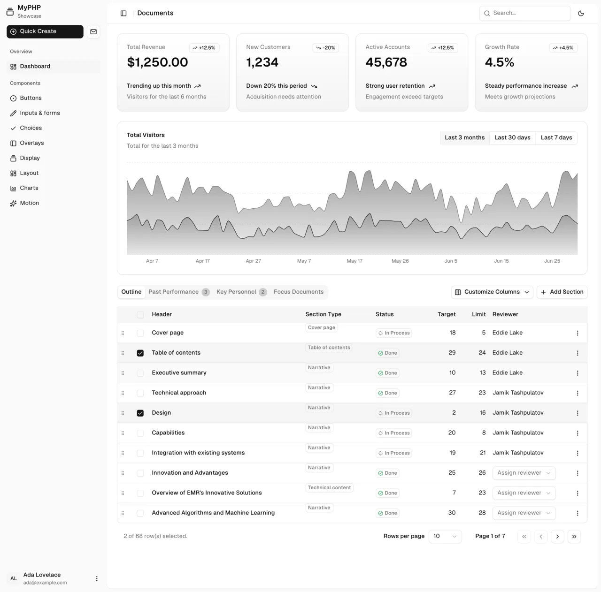

# MyPHP

Native desktop apps in plain PHP, drawn on the GPU.

One 12 MB binary holds PHP, the UI toolkit and its assets. No PHP install, no
webview, no Electron. Apps build into a single file you can send to anyone.



## Install

Linux x86-64 (X11 or XWayland, OpenGL), or macOS on Apple Silicon or Intel (experimental):

```sh
curl -fsSL https://raw.githubusercontent.com/crabphp/myphp/main/install.sh | sh
```

Later, `myphp upgrade` updates it. For the newest unreleased build from `main`, install
with `curl -fsSL https://raw.githubusercontent.com/crabphp/myphp/main/install.sh | sh -s -- --nightly`;
`myphp upgrade` then keeps you on nightly builds (`--stable` goes back to releases).

Windows x86-64 (experimental), in PowerShell:

```powershell
irm https://raw.githubusercontent.com/crabphp/myphp/main/install.ps1 | iex
```

## Create an app

```sh
myphp init hello
cd hello
myphp run --watch    # reloads when you save
```

A small app:

```php
<?php
use PhpUi\App;
use function PhpUi\{button, col, state, text, textInput};

$state = state(new class {
    public int $count = 0;
    public string $name = '';
});

$render = fn () => col()->full()->p(24)->gap(12)->schema([
    text('Count: ' . $state->count)->textSize(26)->bold(),
    button('Add')->icon('plus')->onClick(fn () => $state->count++),
    textInput('name')->label('Your name')->bind($state->name),
    text($state->name === '' ? 'Type your name' : "Hello, {$state->name}"),
]);

(new App('Hello', 480, 360, $render))->run();
```

The UI is a function of state: change `$state`, and the next frame shows it.
`->bind($state->name)` connects an input to a property both ways.

## Ship it

```sh
myphp build
```

You get `build/hello`, one executable with everything inside.

## Composer packages

```sh
composer require guzzlehttp/guzzle
```

`vendor/` loads by itself and is packed into `myphp build`. `composer install` also
gives your editor autocompletion for the toolkit. Apps that use HTTPS, SQLite or XML
run on a larger runtime that myphp picks and downloads by itself.

## What's inside

- **Layout:** flexbox rows and columns, grids, wrapping rows, gap, padding, grow,
  align, scrolling, wrapping text and images.
- **Text editing:** inputs and textareas with a caret, mouse selection, word jumps,
  copy/paste, undo/redo and Tab between fields.
- **Filament-style API:** chain settings (`card()->heading(...)->schema([...])`), and
  `->bind($state->email)` connects inputs to state both ways.
- **Components:** shadcn/ui style buttons, inputs, select, tabs, table, dialog,
  dropdown menu, tooltip, toast, switch, slider, charts and more, with smooth
  hover and focus transitions.
- **State:** `state()` with a typed object your editor autocompletes; timers;
  a data folder per app.
- **Live reload:** `myphp run --watch` restarts the window when you save.
- **Audio:** play MP3, FLAC and WAV with `GL\Audio\Engine`, built in; see the player demo.
- **Keyboard and zoom:** Tab to every control, Enter/Space/arrows/Escape, a focus ring,
  Ctrl/Cmd +/− zoom, reduced motion and accessible names ([details](docs/accessibility.md)).
- **Desktop:** file dialogs, notifications, clipboard, file drop, open links,
  follow system dark mode.
- **Fast:** one GPU draw for all boxes and shadows; the app sleeps when idle.

Try the examples in [`examples/`](examples): a dashboard, a component gallery,
notes, a mail client, a music player, a log viewer, a todo list and desktop APIs.

```sh
git clone https://github.com/crabphp/myphp
cd myphp/examples
myphp run gallery.php     # also: dashboard, desktop, logs, mail, notes, player, todo
```


## Docs

- [Getting started](docs/getting-started.md)
- [CLI](docs/cli.md)
- [Layout](docs/layout.md)
- [Components](docs/components.md)
- [Desktop](docs/desktop.md)
- [Accessibility](docs/accessibility.md)
- [Contributing](docs/contributing.md)

## Status

Early. Screen readers: VoiceOver on macOS (experimental), not yet on Linux or
Windows. Linux is the main platform; macOS and Windows are experimental (built and
smoke-tested by CI, not yet tested on real hardware). Not yet: tray icons, menus,
multiple windows, global shortcuts.

## License

MIT. Fonts: Geist (SIL OFL). Icons: Lucide (ISC).
