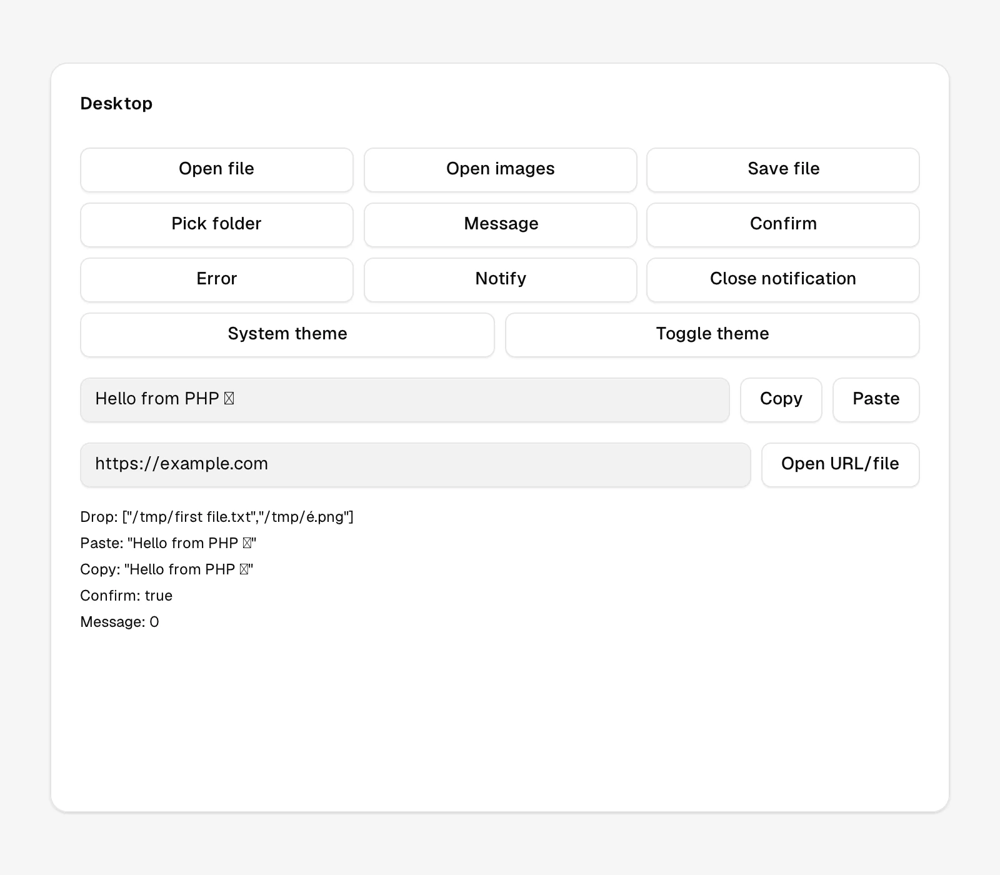

# MyPHP

Native desktop apps in plain PHP, drawn on the GPU (Vulkan, Metal, Direct3D 12).

One binary of about 15 MB holds PHP, the UI toolkit and its assets. No PHP install,
no webview, no Electron. Apps build into a single file you can send to anyone.


## Install

Linux x86-64 (X11 or Wayland, a Vulkan driver), or macOS 11+ on Apple Silicon or Intel:

```sh
curl -fsSL https://raw.githubusercontent.com/crabphp/myphp/main/install.sh | sh
```

Later, `myphp upgrade` updates it. For the newest unreleased build from `main`, install
with `curl -fsSL https://raw.githubusercontent.com/crabphp/myphp/main/install.sh | sh -s -- --nightly`;
`myphp upgrade` then keeps you on nightly builds (`--stable` goes back to releases).

Windows x86-64 (Direct3D 12; experimental), in PowerShell:

```powershell
irm https://raw.githubusercontent.com/crabphp/myphp/main/install.ps1 | iex
```

## Create an app

```sh
myphp init hello
cd hello
myphp run --watch    # hot reload: saves show up instantly, state kept
```

A small app:

```php
<?php
use PhpUi\App;
use function PhpUi\{button, col, state, text, textInput};

$state = state(new class {
    public int $count = 0;
    public string $name = '';
});

$render = fn () => col()->full()->p(24)->gap(12)->schema([
    text('Count: ' . $state->count)->textSize(26)->bold(),
    button('Add')->icon('plus')->onClick(fn () => $state->count++),
    textInput('name')->label('Your name')->bind($state->name),
    text($state->name === '' ? 'Type your name' : "Hello, {$state->name}"),
]);

(new App('Hello', 480, 360, $render))->run();
```

The UI is a function of state: change `$state`, and the next frame shows it.
`->bind($state->name)` connects an input to a property both ways.

## Ship it

```sh
myphp build
```

You get `build/hello`, one executable with everything inside.

## Composer packages

```sh
composer require guzzlehttp/guzzle
```

`vendor/` loads by itself and is packed into `myphp build`. `composer install` also
gives your editor autocompletion for the toolkit. Apps that use HTTPS, SQLite or XML
run on a larger runtime that myphp picks and downloads by itself.

## What's inside

- **Layout:** flexbox rows and columns, grids, wrapping rows, gap, padding, grow,
  align, scrolling, wrapping text and images.
- **Text:** shaped by HarfBuzz (ligatures, accents, complex scripts), with the
  system's fonts as fallbacks for Chinese, Japanese, Korean, emoji and more.
- **Text editing:** inputs and textareas with a caret, mouse selection, word jumps,
  copy/paste, undo/redo, Tab between fields, and input methods (IBus, Fcitx, macOS
  and Windows IMEs) for Vietnamese, Chinese, Japanese and others.
- **Filament-style API:** chain settings (`card()->heading(...)->schema([...])`), and
  `->bind($state->email)` connects inputs to state both ways.
- **Components:** shadcn/ui style buttons, inputs, select, tabs, table, dialog,
  dropdown menu, tooltip, toast, switch, slider, charts and more, with smooth
  hover and focus transitions.
- **State:** `state()` with a typed object your editor autocompletes; timers;
  a data folder per app.
- **Hot reload:** `myphp run --watch` reloads your code in the running window when
  you save, keeping state, focus and scroll; errors show in the window
  ([details](docs/cli.md#run)).
- **Canvas:** `canvas()` draws with the HTML canvas 2D API: paths, arcs, Béziers,
  SVG path data, gradients, patterns, clipping, shadows, transforms, text and images
  ([details](docs/layout.md#canvas)).
- **Audio:** play MP3, FLAC and WAV with `GL\Audio\Engine`, built in; see the player demo.
- **Keyboard and zoom:** Tab to every control, Enter/Space/arrows/Escape, a focus ring,
  Ctrl/Cmd +/− zoom, reduced motion and accessible names ([details](docs/accessibility.md)).
- **Desktop:** file dialogs, notifications, clipboard, file drop, open links,
  follow system dark mode.
- **Fast:** boxes, borders, shadows, text and icons drawn in a few GPU calls with
  SDL_GPU (Vulkan, Metal, Direct3D 12); the app sleeps when idle.

Try the examples in [`examples/`](examples): a showcase (a dashboard and every
component with its code), notes, a mail client, a music player, a pocket player with a click wheel, a log viewer, a todo list and desktop APIs.

```sh
git clone https://github.com/crabphp/myphp
cd myphp/examples
myphp run showcase.php    # also: desktop, logs, mail, notes, player, pocket, todo
```



## Docs

- [Getting started](docs/getting-started.md)
- [CLI](docs/cli.md)
- [Layout](docs/layout.md)
- [Components](docs/components.md)
- [Desktop](docs/desktop.md)
- [Accessibility](docs/accessibility.md)
- [Contributing](docs/contributing.md)

## Status

Early. Screen readers: VoiceOver on macOS (experimental), not yet on Linux or
Windows. Linux and macOS run on real hardware; Windows is experimental (built and
smoke-tested by CI on Direct3D 12's software adapter, not yet tested on a real
machine). A GPU driver with Vulkan, Metal or Direct3D 12 is required. See the roadmap
for what is missing.

## Roadmap

Next:

- **Windows on real machines:** test and fix Direct3D 12, input methods and desktop
  APIs on real hardware; a console-free GUI build.
- **Windows and app chrome:** app and context menus, tray icons, multiple windows,
  window options (minimum size, fullscreen, frameless), global shortcuts.
- **Shipping:** app icons, macOS `.app` bundles and DMGs, Windows installers, Linux
  AppImage and `.desktop` files, code signing and notarization, self-updating apps.
- **Screen readers:** Orca on Linux and Narrator/NVDA on Windows (VoiceOver works on
  macOS).

Later:

- **Text:** right-to-left and mixed-direction text (bidi), rich text, find in text.
- **Large data:** virtualized lists and tables for many thousands of rows.
- **Media:** SVG and WebP images, animated GIFs.
- **Developer tools:** an element inspector.
- **Platforms:** Linux and Windows on ARM64; a software fallback for machines without
  Vulkan, Metal or Direct3D 12.

## License

MIT. Fonts: Geist (SIL OFL). Icons: Lucide (ISC).
