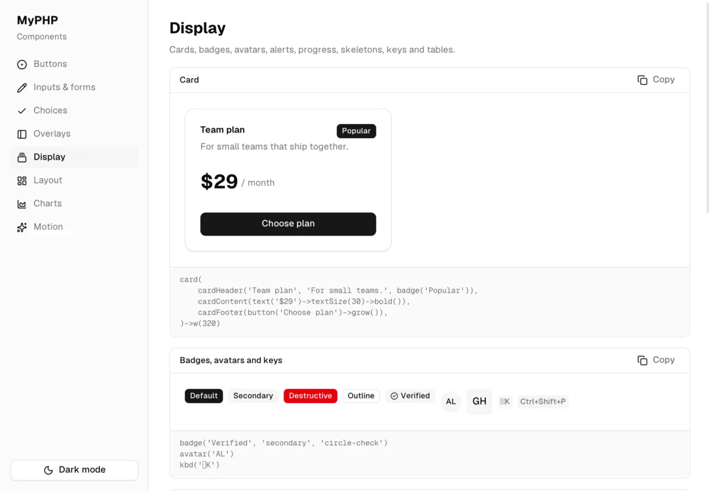

# Components

Components are functions in `PhpUi` (`use function PhpUi\{button, card, textInput};`)
that you configure by chaining, in the style of Filament:

```php
grid(2)->gap(16)->schema([
    card()
        ->heading('Team plan')
        ->description('For small teams.')
        ->headerAction(badge('Popular'))
        ->schema([text('$29')->textSize(30)->bold()])
        ->footer([button('Choose plan')->icon('check')->onClick($choose)]),

    col()->gap(12)->schema([
        textInput('email')->label('Email')->placeholder('you@example.com')->bind($state->email),
        checkbox()->label('Accept the terms')->bind($state->agree),
        select('plan')->options(['free' => 'Free', 'pro' => 'Pro'])->bind($state->plan),
    ]),
]);
```

Conventions:

- **Only the essential argument goes in the call**: a button's label, a field's name,
  a grid's column count. Everything else is a chained method, in any order.
- **`schema([...])`** sets the children of anything: `row()`, `col()`, `grid()`, and the
  content of `card()` and `dialog()`. (`child()` and `children()` still work.)
- **`bind($state->property)`** connects a value component to your state both ways: it
  shows the property and writes changes back, converted to the property's type (int,
  float, bool or string). It works with `state(new class {...})` objects, array
  `state([...])`, and array items such as `$state->notes[$i]['title']`.
- **`afterStateUpdated(fn ($value) => ...)`** runs after a bound value changes, e.g. to save.
- Every component is also an element: `->w()`, `->id()`, `->grow()`, `->textColor()` and the
  rest of the [Layout](layout.md) API apply, and win over the component's own styling.

The older positional forms (`button('Save', $save, 'outline')`,
`textInput('email', $value, $onInput)`, `card(cardHeader(...), cardContent(...))`) keep
working.

Run `myphp run examples/gallery.php` from the repository to try every component live, in
light and dark, with the code for each example next to it (select it, or press Copy).



## Buttons and badges

`button(string $label = '')`

| Method | |
|---|---|
| `->onClick(fn () => ...)` | What a click (or Enter/Space) does |
| `->color('primary' \| 'secondary' \| 'gray' \| 'danger' \| 'ghost' \| 'link' \| 'outline')` | Look; `->outlined()` is `color('outline')` |
| `->size('default' \| 'sm' \| 'lg' \| 'icon' \| 'icon-sm')` | A number still sets width and height |
| `->icon('mail')`, `->iconPosition('after')`, `->iconColor($hex)` | Lucide icon before (or after) the label |
| `->label('Settings')` | The text; for an icon-only button, its accessible name |
| `->tooltip('Saves the file')` | Shown on hover |
| `->disabled()` | Faded, no clicks, skipped by Tab |

`badge(string $label = '')->color('secondary' | 'danger' | 'outline')->icon('sparkles')`

## Card

`card()->heading(string|Element)->description(string|Element)->headerAction(Element)`
`->headerActions([...])->schema([...])->footer([...])`

The positional form takes sections: `card(cardHeader($title, $description, $action), cardContent(...), cardFooter(...))`.

## Fields

`textInput(string $name)` and `textarea(string $name)`; `$name` is the input's id.

| Method | |
|---|---|
| `->bind($state->email)` | Value and updates in one |
| `->label('Email')`, `->helperText('...')` | Text above and below the field |
| `->placeholder('you@example.com')` | Shown while empty |
| `->prefixIcon('mail')` | Icon inside the input (one-line inputs) |
| `->rows(4)` | Height of a textarea, in lines |
| `->onInput(fn ($value) => ...)` | Each change (instead of, or with, `bind()`) |
| `->onSubmit(fn ($value) => ...)` | Enter; Ctrl/Cmd+Enter in a textarea |
| `->afterStateUpdated(fn ($value) => ...)` | After a bound value changed |

Both are full editors: selection, word jumps, copy and paste, undo, and Tab between
fields (see [Layout](layout.md#text)).

## Choices

| Component | Methods |
|---|---|
| `checkbox()` | `->label('Accept the terms')->bind($state->agree)`; or `->checked(bool)->onToggle($fn)` |
| `switchToggle()` | `->label('Email me')->bind($state->emails)`; or `->on(bool)->onToggle($fn)` |
| `select(string $name)` | `->options([value => label])->placeholder('Choose…')->label('Plan')->size('sm')->bind($state->plan)` |
| `slider()` | `->min(0)->max(100)->step(5)->bind($state->volume)`; or `->onChange($fn)` |
| `tabs()` | `->options([value => label])->bind($state->tab)->idPrefix('tab')` |
| `toggleGroup()` | Same as tabs, drawn as connected buttons |

A select, tab or toggle item has the id `"$name-trigger"`, `"$prefix-$value"`. Labels on
checkboxes and switches are part of the control: clicking the text toggles it too.

## Overlays

- `dialog()->heading('Rename')->description('...')->schema([...])->footer([...])->onClose($fn)->width(448)`:
  a modal panel over its parent with a close button. A click outside and Escape call
  `onClose`; Tab stays inside while it is open.
- `toast('Saved')->description('Your changes are safe.')->icon('circle-check')`: a bottom-right
  notice; your state decides how long it shows (for example with `$app->after(3, ...)`).
- `tooltip(string $text, string $side = 'bottom')`: a child shown while its parent is
  hovered; side may be `top`. Buttons have `->tooltip()`.
- `dropdownMenu(array $items, callable $onClose, float $width = 192)`: items are
  `[label, onClick, icon?, shortcut?]` (add `'checked' => bool` for a check column),
  `'separator'`, or `['label' => text]`; place it with absolute insets.
- `messageBox(...)`: the overlay behind `Desktop::message()`, which manages it for you.

## Display

- `alert('Heads up')->description('...')->icon('info')->color('danger')`: a notice panel
  whose text can be selected and copied.
- `paragraph(string $text, ?float $width = null, float $size = 14)`: wrapped text; without a
  width it fills its parent.
- `table(array $columns, array $rows, ?callable $rowId = null, ?string $headBg = null, ?callable $rowStyle = null)`:
  columns are `[key => [label, width|null, align]]`, rows `[key => string|Element]`; null
  widths share the space. `rowId($index)` returns an id, `rowStyle($element, $index)` styles a row.
- `avatar(string $initials, float $size = 32, string $radius = 'full')`, `progress(float $value)`
  (0–100), `skeleton(float|string $w, float $h)`, `separator(bool $vertical = false)`,
  `kbd(string $keys)`.

## Charts

Give each chart a width and height. Use nonempty series with one value per label;
sparklines need at least two values.

- `areaChart(array $labels, array $series, int $ticks = 6)`: stacked areas; series are
  `[name => [color, values[]]]`, bottom series first.
- `barChart(array $labels, array $series)`: grouped bars, same series format.
- `sparkline(array $values, string $color)`: a small smooth line with a shaded area.

## Your own components

Extend `PhpUi\Component` and return the look from `build()`; settings are chained methods,
and `BindsState` adds `bind()` and `afterStateUpdated()`:

```php
final class Rating extends PhpUi\Component
{
    use PhpUi\BindsState;
    private int $stars = 5;

    public function stars(int $count): static { $this->stars = $count; return $this; }

    protected function build(): PhpUi\Element
    {
        $value = (int) $this->current(0);
        return PhpUi\row()->gap(4)->schema(array_map(
            fn ($i) => PhpUi\icon('sparkles', 20, $i <= $value ? PhpUi\t('chart-4') : PhpUi\t('muted'))
                ->onClick(fn () => $this->write($i))->label("$i stars"),
            range(1, $this->stars),
        ));
    }
}

// (new Rating())->stars(5)->bind($state->rating)
```

See [Layout](layout.md) for primitives, sizing and styling, and [Desktop](desktop.md) for
messages, file choosers and notifications.
